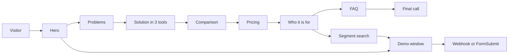
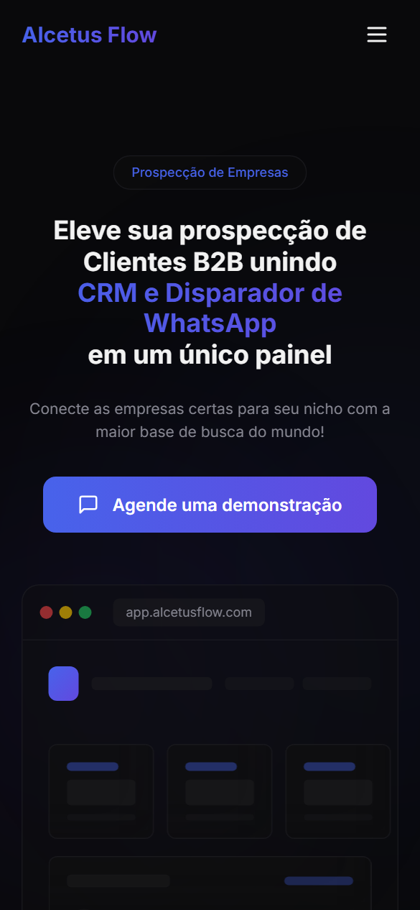
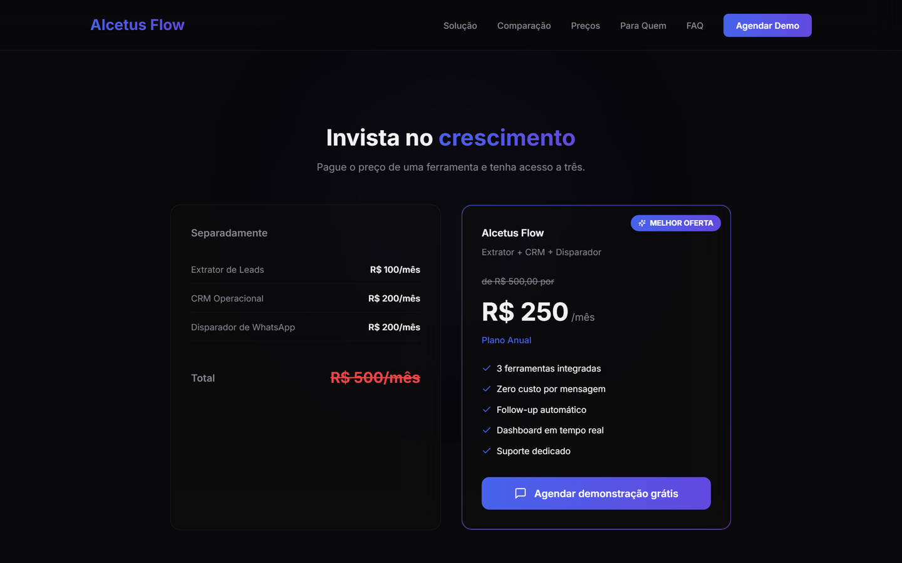
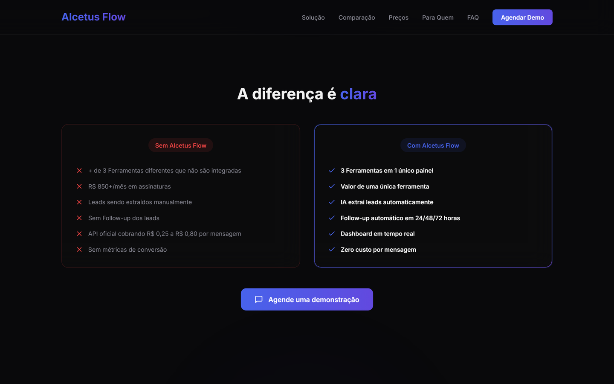
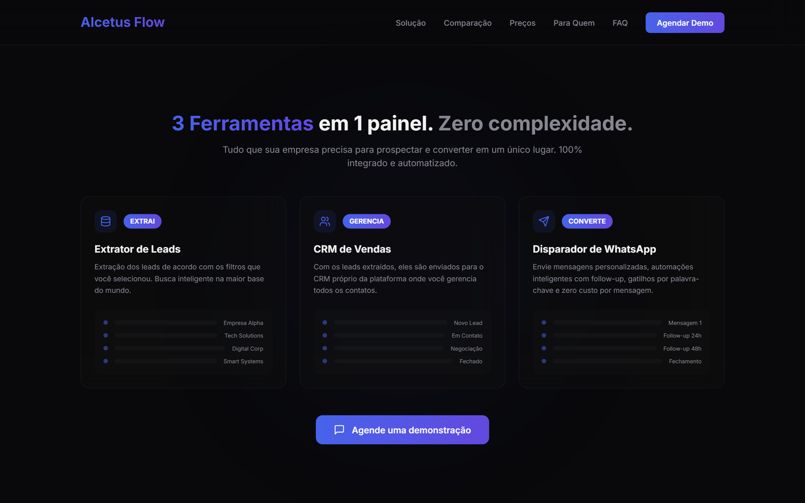
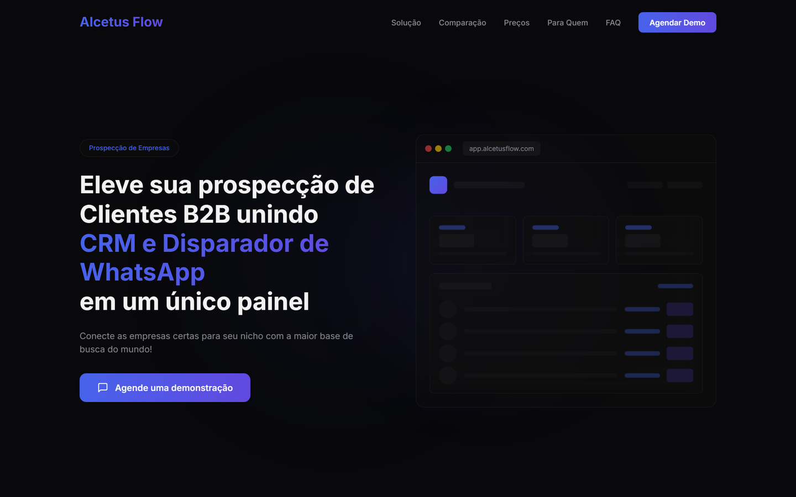
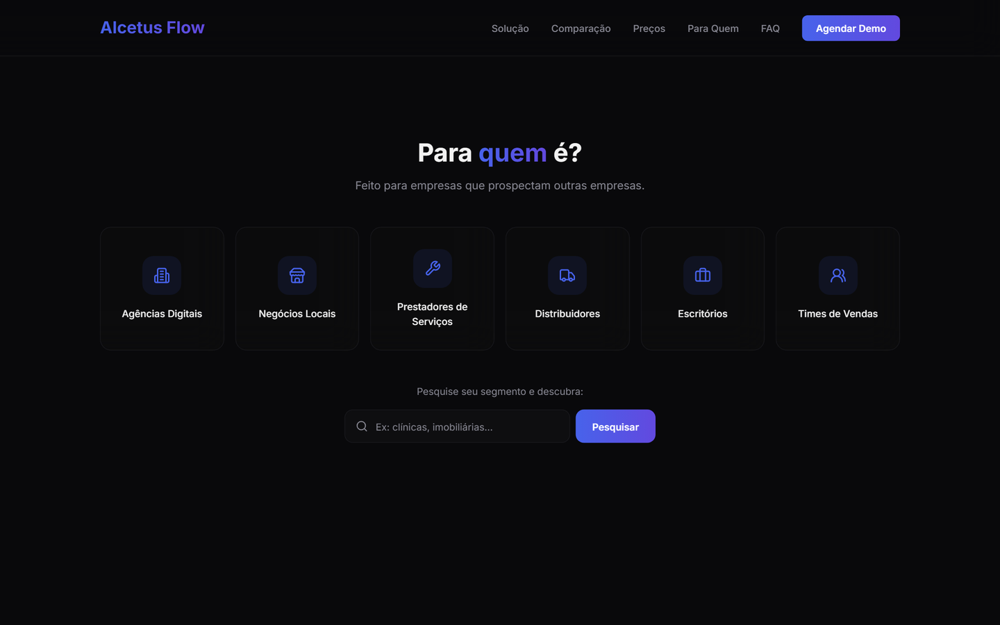
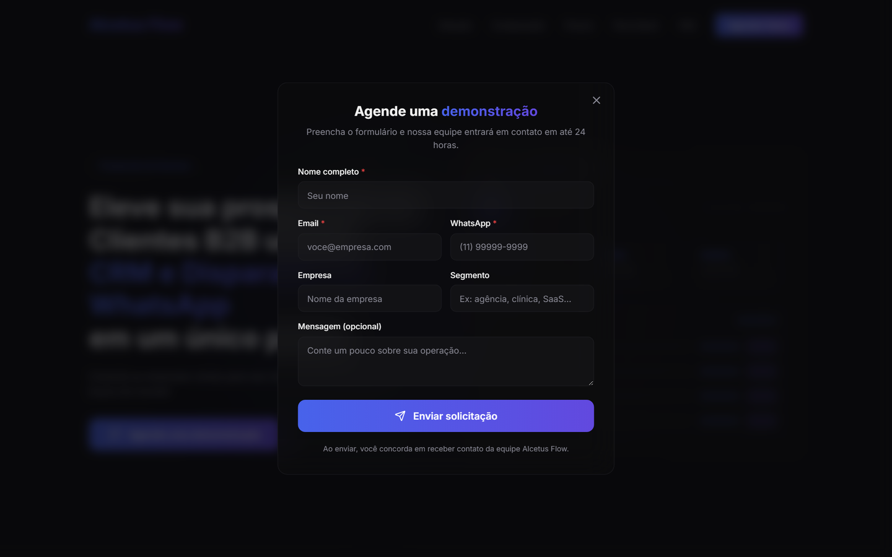
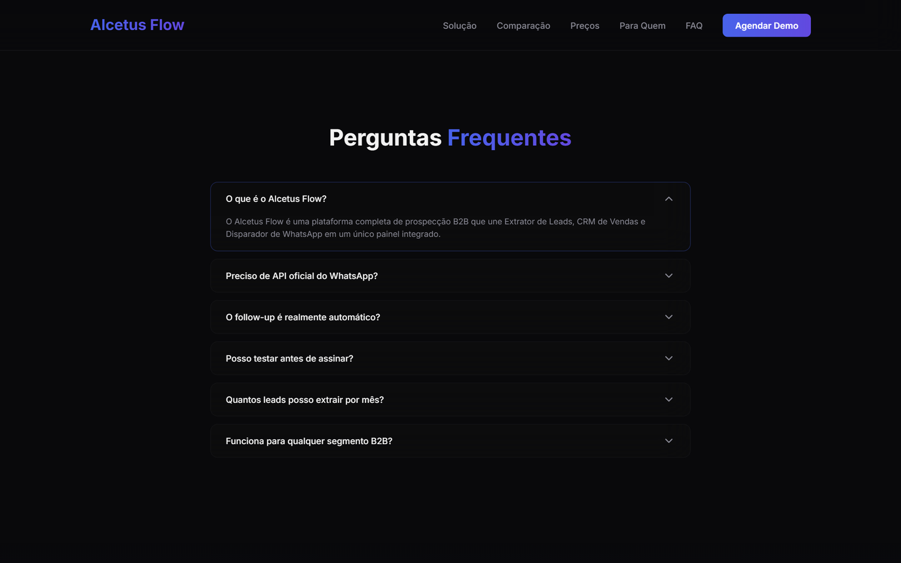
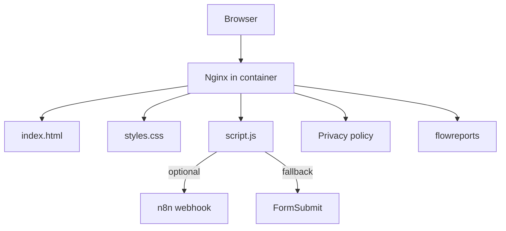

<p align="center"></p>

<h1 align="center">Alcetus Flow</h1>

<p align="center">Landing page for Alcetus Flow, the Alcetus B2B prospecting platform.</p>

<p align="center">
  <kbd>&nbsp;&nbsp; HTML5&nbsp;&nbsp;</kbd> &nbsp;<kbd>&nbsp;&nbsp; CSS&nbsp;&nbsp;</kbd> &nbsp;<kbd>&nbsp;&nbsp; JavaScript&nbsp;&nbsp;</kbd> &nbsp;<kbd>&nbsp;&nbsp; Docker&nbsp;&nbsp;</kbd>
</p>

<p align="center"><a href="./README.md"></a> &nbsp; </p>

> Site: [alcetus.com](https://alcetus.com).

<table>
<tr>
<td align="center" width="50%"><b>HTML · CSS · JS</b><br><sub>no framework</sub></td><td align="center" width="50%"><b>Docker</b><br><sub>deploy ready</sub></td>
</tr>
</table>

### Overview

The alcetus-site repository holds a presentation page built in plain HTML, CSS and JavaScript, with no framework and no build step at all. The current content presents Alcetus Flow, a B2B prospecting platform that brings together a lead extractor, a sales CRM and a WhatsApp sender in a single panel.

The page is a one-route landing with a fixed menu, several content blocks, a demo form in a modal window and a tool that classifies the segment a visitor types. The site goes to production in an Nginx container. The same repository also holds the FlowReports landing and a privacy policy page.

### How it works

1. The visitor opens the page and sees the title, the subtitle and a button to book a demo, next to a mockup of the panel.
2. As they scroll, blocks appear with a soft animation, and the menu changes style.
3. They can type their business segment and find out whether it looks B2B, with an estimated company count.
4. Any demo button opens a window with a form, with a Brazilian phone mask applied.
5. Submission goes to an n8n webhook, when configured, or to the FormSubmit service as a fallback.
6. If sending fails, the page offers to open the visitor's email client with the message ready.



### Features in detail

#### Structure and sections

The page has a menu with the links Solution, Comparison, Pricing, Who it is for and FAQ, plus the demo button. The menu becomes a panel on mobile. Sections follow a sales order.

<p align="center"><br><sub>Hero on mobile (390 px).</sub></p>

<p align="center"><br><sub>Pricing: separate tools versus the single plan.</sub></p>

<p align="center"><br><sub>Comparison between working without and with the product.</sub></p>

<p align="center"><br><sub>Solution: the three tools and each one's flow.</sub></p>

<p align="center"><br><sub>Hero with headline, subtitle, demo button and dashboard mockup.</sub></p>

- Hero with the main title, subtitle, button and a mockup of the panel.
- Problems of manual prospecting, in four cards.
- Solution, with the three tools and each one's flow (extract, manage, convert).
- Comparison between working without and with the product.
- Pricing, with the cost of the separate tools against the single plan.
- Who it is for, with the profiles served and the segment search.
- Testimonials.
- Frequently asked questions and a final call, followed by the footer.

#### Segment search

A field takes the business segment and answers whether it is B2B, B2C or invalid.

<p align="center"><br><sub>Target profiles and the business segment search field.</sub></p>

- With a webhook configured, classification is done by AI in n8n and the response is normalized (the count stays between 20 and 130).
- Without a webhook, or if it fails, classification falls back to a local rule. It rejects text that does not look like a business, such as very few letters, only digits or too many consonants, and treats everything else as B2B.
- The typed segment is escaped before going into the HTML, and the result button opens the modal with the segment prefilled.

#### Demo form

The form collects name, email, WhatsApp, company, segment and message.

<p align="center"><br><sub>Modal window with the demo request form.</sub></p>

- The modal moves focus to the first field, closes on Esc or with the close buttons, and locks page scrolling.
- The phone gets a Brazilian mask with 10 or 11 digits.
- The button has a loading state that prevents double submission.
- A success screen replaces the form after sending.

#### FAQ and animations

The FAQ is an accordion that keeps one item open at a time and updates the aria-expanded attribute. Entrance animations use IntersectionObserver to reveal each block when it reaches the screen. Internal scrolling is smooth.

<p align="center"><br><sub>Accordion FAQ with one item open.</sub></p>

### Architecture and stack

There are three main files, `index.html`, `styles.css` and `script.js`, plus the privacy policy and the flowreports folder. The server is Nginx.



- Styling: HSL tokens in `:root` (dark background, blue-violet primary, 0.75 rem radius), glass and gradient-text utilities, and CSS animations.
- Responsiveness: width breakpoints at 768, 881, 1025, 1201 and 1367 px, with a container of up to 1280 px.
- Font: Inter, loaded through Google Fonts.
- SEO: title, description and Open Graph meta tags.
- Weight: about 58 KB of HTML, 28 KB of CSS and 13 KB of JavaScript, with no content images (icons are SVG inside the HTML).

### Deploy

The Dockerfile starts from `nginx:alpine`, copies the configuration, the page files, the privacy policy and the flowreports folder into the public directory, and exposes port 80. The `nginx.conf` uses `try_files` to serve URLs without the `.html` extension, hides the server version and sets the 404 error page. Locally, you can just open `index.html` or run `docker build` and `docker run`.

### Engineering decisions

- **Plain HTML, CSS and JS.** With no framework or build, the page loads fast and anyone can edit it by opening the file.
- **Design tokens in `:root`.** Colors, radius and borders live in variables, so changing the look means editing one block.
- **A form with two outputs and a safety net.** The webhook is the main route, FormSubmit is the fallback, and the prefilled email covers the failure of both.
- **Classifier with a local fallback.** The segment search works even when the AI is down.
- **Minimal Nginx container.** The final image holds only static files and a short configuration.

### Known limits

- The Dockerfile does not copy a `404.html` file, and Nginx is set to serve it, so the error page depends on that file existing.
- In the local segment-search rule, the company count shown is drawn at random between 20 and 130 and does not come from a real database.
- The site loads Inter through a Google Fonts link, not from a self-hosted file.
- The code has a slot for each webhook URL, and while it is empty submission uses FormSubmit, which requires an activation on first use.
- The testimonials and the price figures are written directly in the HTML.

### Getting started

```bash
# Locally: open index.html in your browser.
# With Docker (port as defined in the Dockerfile):
docker build -t alcetus-site .
docker run -p 8080:80 alcetus-site
```

<sub>Contact: <a href="https://joaocouto.alcetus.com">joaocouto.alcetus.com</a> · <a href="mailto:joaopecouto77@gmail.com">joaopecouto77@gmail.com</a></sub>
