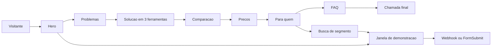
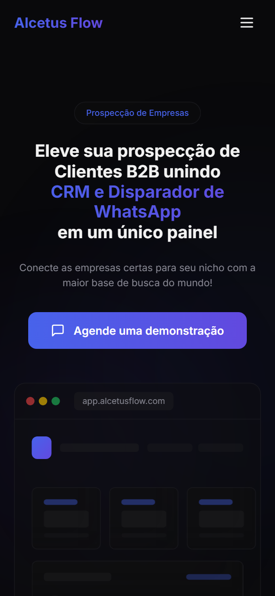
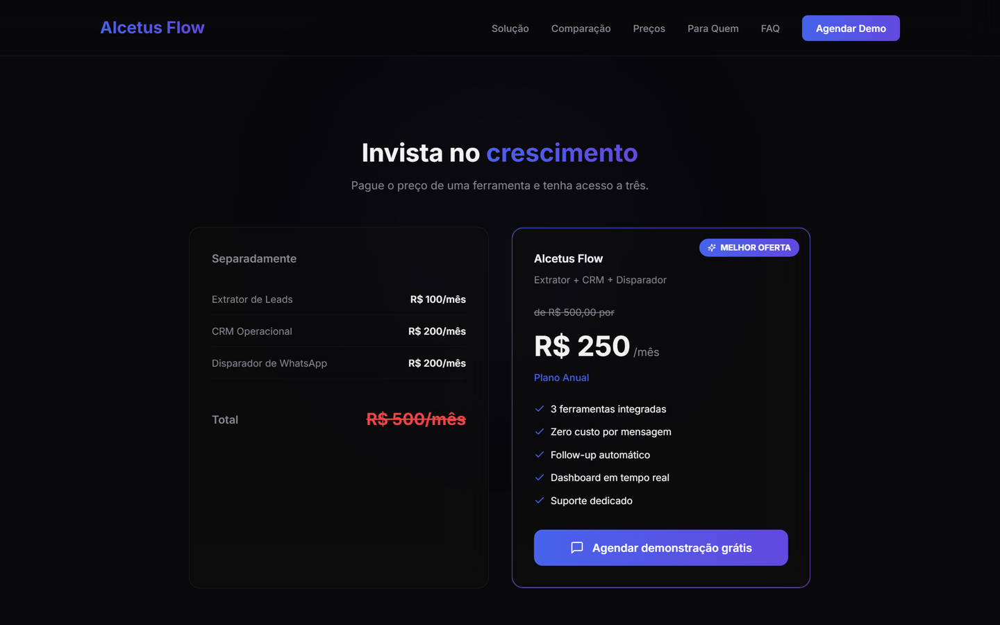
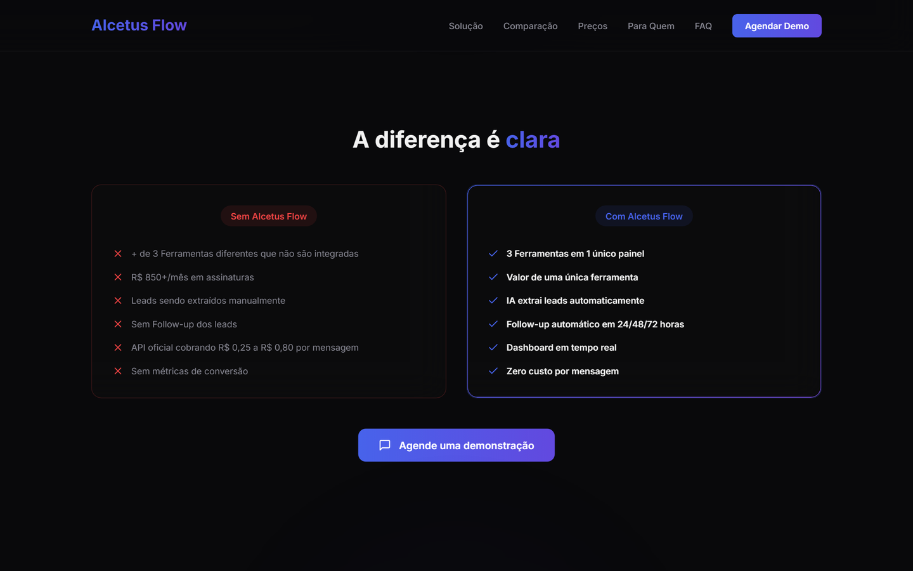
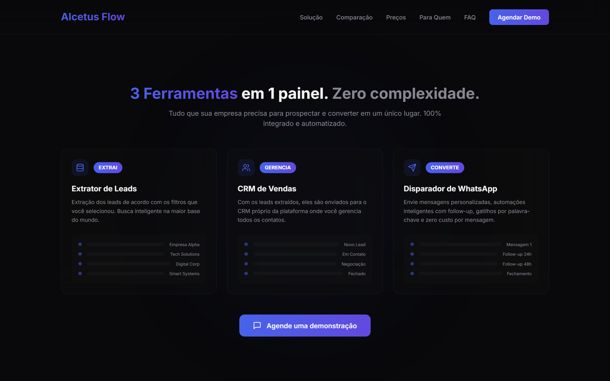
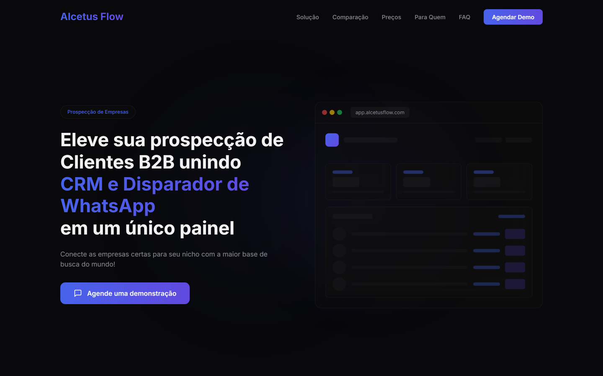
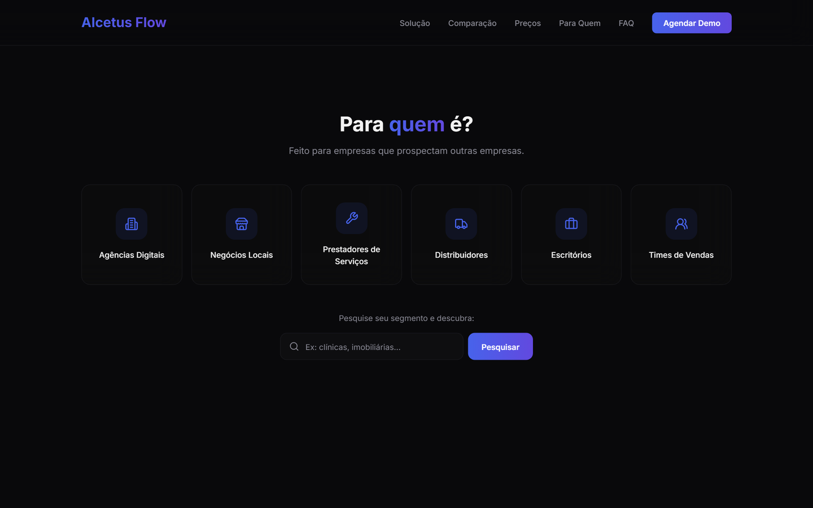
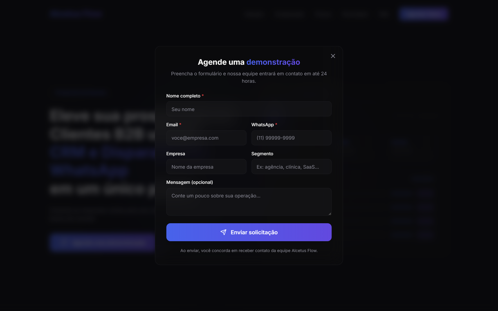
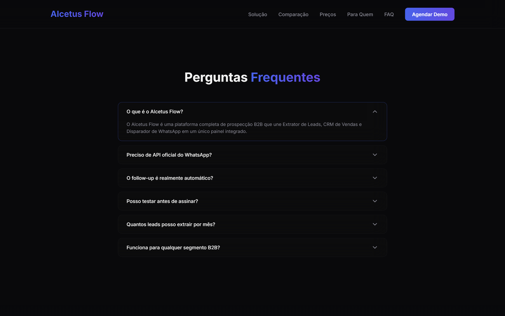
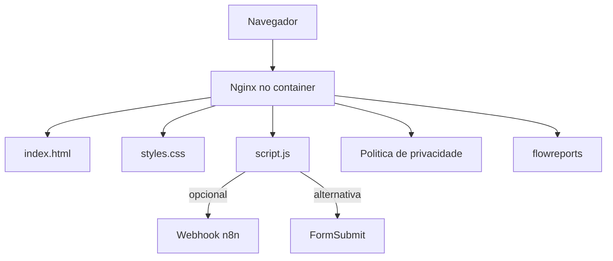

<p align="center"></p>

<h1 align="center">Alcetus Flow</h1>

<p align="center">Landing page do Alcetus Flow, plataforma de prospecção B2B da marca Alcetus.</p>

<p align="center">
  <kbd> HTML5</kbd> <kbd> CSS</kbd> <kbd> JavaScript</kbd> <kbd> Docker</kbd>
</p>

<p align="center"> &nbsp; <a href="./README.en.md"></a></p>

> Site: [alcetus.com](https://alcetus.com).

<table>
<tr>
<td align="center" width="50%"><b>HTML · CSS · JS</b><br><sub>sem framework</sub></td><td align="center" width="50%"><b>Docker</b><br><sub>pronto para deploy</sub></td>
</tr>
</table>

### Visão geral

O repositório alcetus-site guarda uma página de apresentação feita em HTML, CSS e JavaScript puros, sem framework e sem etapa de build. O conteúdo atual apresenta o Alcetus Flow, uma plataforma de prospecção B2B que reúne extrator de leads, CRM de vendas e disparador de WhatsApp em um único painel.

A página é uma landing de uma rota só, com menu fixo, vários blocos de conteúdo, um formulário de demonstração em janela modal e uma ferramenta que classifica o segmento digitado. O site vai para produção em um container Nginx. Dentro do mesmo repositório há também a landing do FlowReports e uma página de política de privacidade.

### Como funciona

1. A visitante abre a página e vê o título, o subtítulo e o botão para agendar uma demonstração, ao lado de uma maquete do painel.
2. Ao rolar, os blocos aparecem com uma animação suave, e o menu muda de estilo.
3. Ela pode digitar o segmento do negócio e descobrir se ele parece B2B, com uma contagem estimada de empresas.
4. Qualquer botão de demonstração abre uma janela com formulário, com a máscara de telefone brasileiro aplicada.
5. O envio vai para um webhook do n8n, quando configurado, ou para o serviço FormSubmit como alternativa.
6. Se o envio falhar, a página oferece abrir o e-mail da visitante com a mensagem pronta.



### Funcionalidades em detalhe

#### Estrutura e seções

A página tem um menu com os links Solução, Comparação, Preços, Para quem e FAQ, mais o botão de demonstração. O menu vira um painel no celular. As seções seguem uma ordem de venda.

<p align="center"><br><sub>Hero na versão mobile (390 px).</sub></p>

<p align="center"><br><sub>Preços: ferramentas separadas contra o plano único.</sub></p>

<p align="center"><br><sub>Comparação entre trabalhar sem e com o produto.</sub></p>

<p align="center"><br><sub>Solução: as três ferramentas e o fluxo de cada uma.</sub></p>

<p align="center"><br><sub>Hero com título, subtítulo, botão de demonstração e maquete do painel.</sub></p>

- Hero com o título principal, o subtítulo, o botão e uma maquete do painel.
- Problemas da prospecção manual, em quatro cartões.
- Solução, com as três ferramentas e o fluxo de cada uma (extrai, gerencia, converte).
- Comparação entre trabalhar sem e com o produto.
- Preços, com o custo das ferramentas separadas contra o plano único.
- Para quem é, com os perfis atendidos e a busca por segmento.
- Depoimentos.
- Perguntas frequentes e chamada final, seguidas do rodapé.

#### Busca por segmento

Um campo recebe o segmento do negócio e responde se ele é B2B, B2C ou inválido.

<p align="center"><br><sub>Perfis atendidos e campo de busca por segmento de negócio.</sub></p>

- Com um webhook configurado, a classificação é feita por IA no n8n e a resposta é normalizada (a contagem fica entre 20 e 130).
- Sem webhook, ou se ele falhar, a classificação cai para uma regra local. Ela rejeita texto sem cara de negócio, como poucas letras, só números ou consoantes demais, e trata o resto como B2B.
- O segmento digitado é escapado antes de ir para o HTML, e o botão do resultado abre a janela já com o segmento preenchido.

#### Formulário de demonstração

O formulário coleta nome, e-mail, WhatsApp, empresa, segmento e mensagem.

<p align="center"><br><sub>Janela modal com o formulário de demonstração.</sub></p>

- A janela modal move o foco para o primeiro campo, fecha com Esc ou pelos botões de fechar e bloqueia a rolagem da página.
- O telefone recebe máscara brasileira com 10 ou 11 dígitos.
- Há estado de carregamento no botão, que impede envio duplo.
- A tela de sucesso substitui o formulário depois do envio.

#### FAQ e animações

O FAQ é um acordeão que mantém um item aberto por vez e atualiza o atributo aria-expanded. As animações de entrada usam IntersectionObserver para revelar cada bloco quando ele aparece na tela. Os rolamentos internos são suaves.

<p align="center"><br><sub>FAQ em acordeão, com um item aberto.</sub></p>

### Arquitetura e stack

São três arquivos principais, `index.html`, `styles.css` e `script.js`, mais a política de privacidade e a pasta flowreports. O servidor é um Nginx.



- Estilo: tokens em HSL no `:root` (fundo escuro, primária azul-violeta, raio de 0,75 rem), utilitários de vidro e de texto em gradiente, e animações em CSS.
- Responsividade: faixas de largura em 768, 881, 1025, 1201 e 1367 px, com contêiner de até 1280 px.
- Fonte: Inter, carregada pelo Google Fonts.
- SEO: título, descrição e metatags Open Graph.
- Peso: cerca de 58 KB de HTML, 28 KB de CSS e 13 KB de JavaScript, sem imagens de conteúdo (os ícones são SVG no próprio HTML).

### Deploy

O Dockerfile parte de `nginx:alpine`, copia a configuração, os arquivos da página, a política de privacidade e a pasta flowreports para o diretório público e expõe a porta 80. O `nginx.conf` usa `try_files` para entregar URLs sem extensão `.html`, esconde a versão do servidor e define a página de erro 404. Localmente, basta abrir o `index.html` ou rodar `docker build` e `docker run`.

### Decisões de engenharia

- **HTML, CSS e JS puros.** Sem framework nem build, a página carrega rápido e qualquer pessoa edita abrindo o arquivo.
- **Tokens de design no `:root`.** Cores, raio e bordas ficam em variáveis, então mudar o visual é editar um bloco.
- **Formulário com duas saídas e uma rede de segurança.** O webhook é a rota principal, o FormSubmit é a alternativa, e o e-mail pré-preenchido cobre a falha dos dois.
- **Classificador com fallback local.** A busca por segmento funciona mesmo sem a IA no ar.
- **Container Nginx mínimo.** A imagem final contém só os arquivos estáticos e uma configuração curta.

### Limites conhecidos

- O Dockerfile não copia um arquivo `404.html`, e o Nginx está configurado para servi-lo, então a página de erro depende de esse arquivo existir.
- Na regra local da busca por segmento, a quantidade de empresas mostrada é sorteada entre 20 e 130 e não vem de uma base real.
- O site carrega o Inter por link do Google Fonts, e não por arquivo próprio.
- O código tem um espaço para a URL de cada webhook, e enquanto ele está vazio o envio usa o FormSubmit, que exige uma ativação no primeiro uso.

### Como rodar

```bash
# Localmente: abra o index.html no navegador.
# Com Docker (porta conforme o Dockerfile):
docker build -t alcetus-site .
docker run -p 8080:80 alcetus-site
```

<sub>Contato: <a href="https://joaocouto.alcetus.com">joaocouto.alcetus.com</a> · <a href="mailto:joaopecouto77@gmail.com">joaopecouto77@gmail.com</a></sub>
